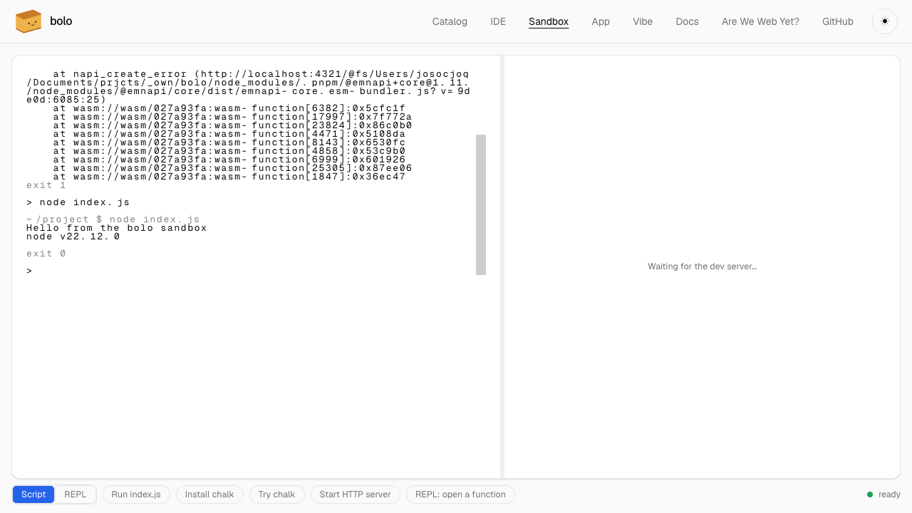
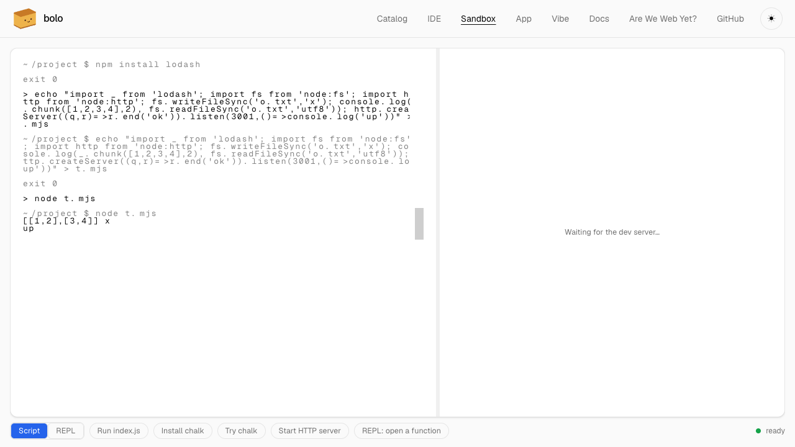
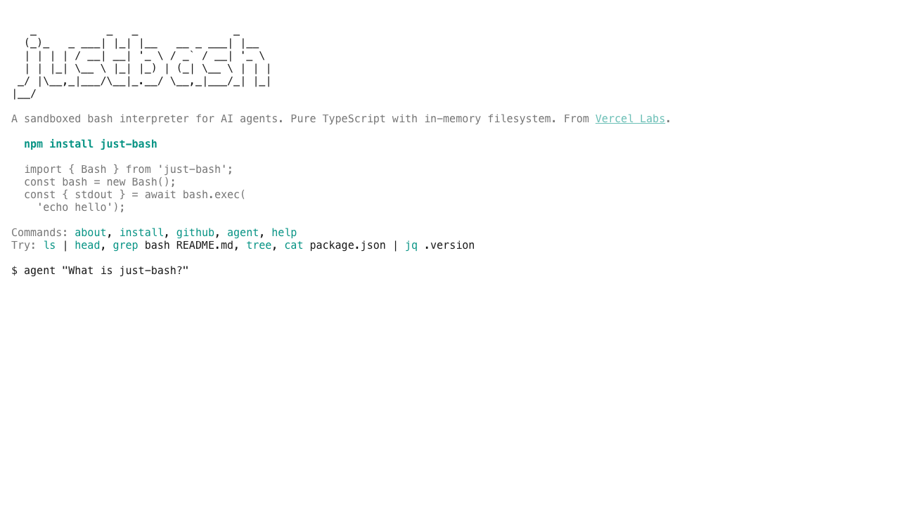
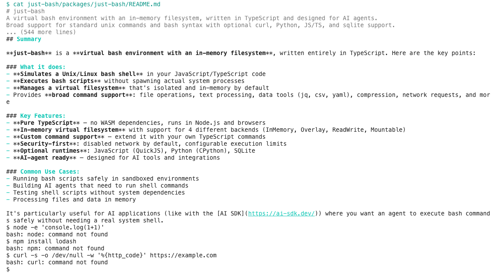
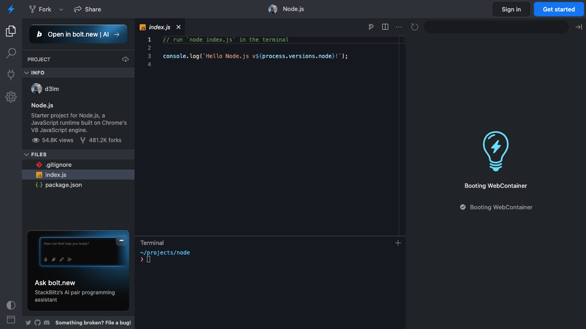

# Competitive comparison: bolo /sandbox

Date: 2026-11-14. Scope: terminal and script execution only (bolo `/sandbox`, see `apps/site/landing/src/subsites/sandbox/SandboxApp.tsx`).
Evidence levels: "tested" means I drove it in a real browser with playwright-cli in this run. "docs" means fetched from official pages this run. "background" means prior knowledge, not re-verified, treat as lower confidence.

## Assumptions and limits

- bolo was run from the Astro dev server (`astro dev --port 4321`), not a production build. Boot times are therefore pessimistic (unbundled Vite deps).
- Only free, no-login tiers were exercised. e2b, Daytona, Modal, Vercel Sandbox, Cloudflare Sandbox need accounts or API keys: docs comparison only.
- StackBlitz WebContainers: a first session ran `node -e` with fs successfully; the follow-up session could not reopen the browser (playwright-cli failed to open), so npm install and curl were not tested there. Treated as partially tested.
- JSLinux, v86, WebVM, Pyodide/JupyterLite, RunKit, Val Town, Deno playground, QuickJS sandboxes, Modal, nodebox were not driven in a browser (time box 60 min). Their rows are docs or background only.
- Time box was 60 minutes, so the usability log covers three live products: bolo, just-bash, StackBlitz.

## Feature matrix

Legend: Y yes, P partial, N no, ? unverified.

| Product | Where code runs | Real Node/V8 | Shell and pipes | npm install | Outbound network | Persistence | Embeddable | License | Price |
|---|---|---|---|---|---|---|---|---|---|
| bolo /sandbox | Client (browser workers) | Y (v22.12.0 reported, tested) | Y: pipes, `&&`, `ls`, `cat` (tested) | Y (tested, lodash) | P: curl failed to fetch (CORS likely); no raw TCP without relay | N: files lost on reload (tested) | Y: npm packages | Apache-2.0 | Free, no server cost |
| just-bash (justbash.dev) | Client or Node, JS interpreter | N: no `node`, optional QuickJS `js-exec` (Node only) | Y (broad: grep, sed, awk, jq) | N | Off by default, allow-listed curl on Node | In-memory, overlay FS on Node | Y (npm lib) | Apache-2.0 (docs) | Free; beta |
| StackBlitz WebContainers | Client (WASM + SW) | Y (tested `node -e` + fs) | Y (jsh) | Y (docs; npm/pnpm/yarn) | P: browser-limited, no raw TCP | Per-project on StackBlitz; API is in-memory | Y (WebContainer API) | Proprietary; commercial license for production use (docs: contact sales) | Free for OSS and dev, paid for commercial |
| Nodebox (CodeSandbox/Sandpack) | Client | P: partial Node | P | Y | P | N | Y (Sandpack) | Source-available, restrictive (background) | Free in Sandpack (background) |
| JSLinux / v86 | Client x86 emulator | Y (full Linux, slow) | Y (real shell) | Y if networked | P (relay) | Disk images | P | MIT (v86), proprietary (JSLinux) (background) | Free |
| WebVM (CheerpX) | Client x86 JIT in WASM | Y (Debian) | Y | Y | P (Tailscale relay, background) | IndexedDB overlay (background) | Y (CheerpX) | Free for non-commercial, paid commercial (background) | Free tier; commercial paid |
| Pyodide / JupyterLite | Client | N (Python) | P | pip via micropip | P | IndexedDB | Y | MPL-2.0 / BSD (background) | Free |
| RunKit / Val Town / Repl.it | Server | Y | P (no real shell on RunKit) | Y | Y | Y (account) | P (embed) | Proprietary | Free tier with login |
| e2b | Server Firecracker microVM | Y | Y full Linux | Y | Y | Up to 1h Hobby, 24h Pro (docs) | SDK | Apache-2.0 infra (background) | Hobby: $100 one-time credit, no card; usage $0.000014/vCPU-s (docs) |
| Daytona | Server | Y | Y | Y | Y | Y | SDK | AGPL-3.0 OSS (background) | $200 free credit; $0.0504/vCPU-h (docs); sub 90ms creation claimed |
| Vercel Sandbox | Server Firecracker microVM | Y (Node LTS, Python 3.14) | Y root | Y | Y, policy controlled | Persistent by default, snapshots (docs) | SDK, CLI | SDK OSS, service proprietary | Active CPU pricing, ~$1/day idle 1vCPU example (docs) |
| Cloudflare Sandbox | Server microVM / Workers | Y (any language) | Y | Y | Can disable internet (docs) | Snapshots, R2 mounts (docs) | Workers SDK | Proprietary service | Workers Paid plan required (docs) |
| Modal sandboxes | Server | Y | Y | Y | Y | Volumes | SDK | Proprietary | Pay per use (background) |
| Deno Deploy playground | Server (V8 isolate) | N: Deno, not Node | N | npm: specifiers | Y | Account | N | Proprietary | Free tier (background) |
| QuickJS/Wasm sandboxes | Client or server | N: QuickJS, no Node APIs | N | N | None by default | N | Y | MIT | Free |

## Server vs client tradeoffs

- Isolation: server microVMs (e2b, Vercel, Cloudflare, Daytona) give kernel-level isolation and are the right answer for untrusted code at scale. bolo relies on browser sandbox (workers + iframe); it protects the host machine of the visitor, not a multi-tenant server, which is the intended model. just-bash explicitly says no VM isolation.
- Cold start: bolo needs a page load and wasm bundler load (3.9 s to 6.2 s dev mode to "ready"). Server sandboxes claim ms to sub-second creation but add network latency and a billing meter.
- Cost: client-side runtime moves compute to the user, zero marginal cost for the host. Server sandboxes bill per second (Daytona $0.0504/vCPU-h, e2b $0.000014/vCPU-s).
- Node API coverage: real servers give full Linux (native modules, Python, git). Browser runtimes (bolo, WebContainers) cannot run native addons or raw sockets.
- npm install: works in bolo and WebContainers, not in just-bash.
- Network: browser CORS restricts outbound calls; server sandboxes have full internet.
- Persistence: server products offer snapshots and volumes. bolo lost all files on reload.
- Embeddability: bolo and WebContainers ship as libraries; server products need a backend and API key.
- Licensing: bolo and just-bash are OSS. WebContainers needs a commercial license for production.

## Usability log

Identical tasks. Screenshots in `assets/sandbox/`.

### bolo /sandbox (tested, dev server, Chromium via playwright-cli)

- Boot: reload to `data-boot-state=ready` took 6227 ms (first), 3906 ms (second). Dev mode.
- `node index.js`: prints "Hello from the bolo sandbox" and "node v22.12.0", exit 0. Screenshot: 
- `node -e "console.log(1+1)"`: FAILS. Output "Build failed with 1 error: Cannot resolve module /home/web/-e". `-e` is treated as a file path and a raw wasm stack trace leaks to the terminal (exit 1).
- `ls`, `ls | grep json`, `echo hi && pwd`, `cat package.json | head -2`: all work. Note `pwd` prints `/home/web` while the prompt says `~/project`.
- `npm install lodash`: exit 0 after about 26 s, silent (no progress or package output).
- Script using lodash, `node:fs` write and read, `node:http` createServer (written via `echo ... > t.mjs`, then `node t.mjs`): prints `[[1,2],[3,4]] x` and `up`. Screenshot: 
- `curl https://example.com`: "curl: Failed to fetch".
- `git --version`: fails; `python3`: exit 127 with message to use the Node.js bundle.
- Persistence: after page reload `ls` showed only the starter files; lodash install and `t.mjs` were gone.
- Console: one 504 "Outdated Optimize Dep" error on first load (dev toolbar), unrelated to runtime.
- The terminal input is a hidden textbox; the preview pane shows "Waiting for the dev server…" until a server starts.

### just-bash (justbash.dev) (tested)

- Instant load, ASCII banner, commands `about, install, github, agent, help`. Screenshots:  
- `node -e ...`: "bash: node: command not found". `npm`: not found. `curl`: not found in the web demo.
- Pipes and builtin text tools work (it is a bash reimplementation). No Node runtime at all in the browser build.

### StackBlitz WebContainers (partial)

- `stackblitz.com/fork/node` loaded an editor and terminal without sign in, about 30 s to a usable terminal on this machine. Screenshot: 
- `node -e "console.log(require('fs').readdirSync('.'))"` printed `[ '.gitignore', 'index.js', 'package.json' ]`.
- npm install, pipes, curl: not completed, browser session failed to reopen. Not claimed.

### Not driven

e2b, Daytona, Vercel Sandbox, Cloudflare, Modal (need keys/accounts); JSLinux, WebVM, Pyodide, RunKit, Val Town, Deno, Nodebox (time box).

## Where bolo is worse

1. No persistence: sandbox state resets on reload. WebContainers (per project), server sandboxes (snapshots) keep state.
2. `node -e` and flags unsupported, and errors dump raw wasm stack traces.
3. Silent `npm install` (26 s with no feedback), versus WebContainers' live npm output.
4. Outbound network limited to browser CORS; `curl` fails. Server sandboxes have full internet.
5. No native modules, git, or Python; just a Node subset. Full Linux emulators (WebVM) and microVMs do all of it.
6. Boot of 4 to 6 s (dev mode) before first command; just-bash is instant.
7. Prompt/cwd mismatch (`~/project` vs `/home/web`), no tab completion tested, no file editor in this subsite (terminal only).
8. Command parsing is `line.split(/\s+/)` in `SandboxApp.tsx`, so quoted arguments passed to `spawn` are not handled by the app layer (only through the shell service, which I did not stress).
9. Isolation is browser-level only; no multi-tenant story for hosting untrusted code at scale.

Where bolo is better: real Node semantics in a pure client with OSS licensing (WebContainers is proprietary), zero server cost, real http server with in-page preview, npm install works, shell pipes work, embeddable as packages.

## Prioritized gap list

1. P0: persist VFS to OPFS/IndexedDB across reloads (vfs-bus already has an OPFS layer; wire it in the sandbox subsite).
2. P0: support `node -e` / `-p` / stdin and fix error output (hide wasm frames, show the real message).
3. P1: stream `npm install` progress and show a spinner or timing.
4. P1: allow-listed outbound fetch/curl via a documented proxy option; surface a clear message instead of "Failed to fetch".
5. P1: production-build cold-start measurement and a warm-boot target (service worker cache); re-measure outside dev mode.
6. P2: fix prompt cwd vs `pwd` mismatch.
7. P2: add git (isomorphic-git shim) and clear `python3` guidance.
8. P2: compat-matrix page entries for WebContainers, just-bash, Nodebox so the landing page makes the comparison itself.
9. P3: finish a driven comparison for WebVM, JSLinux, Pyodide, RunKit, Val Town, and keyed server sandboxes once credentials exist.
